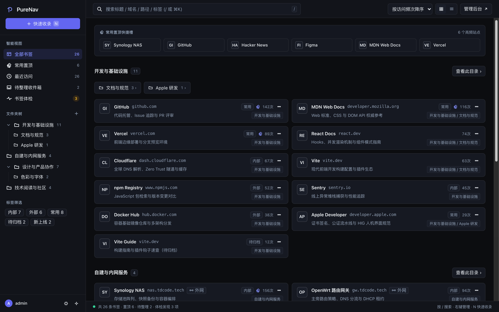
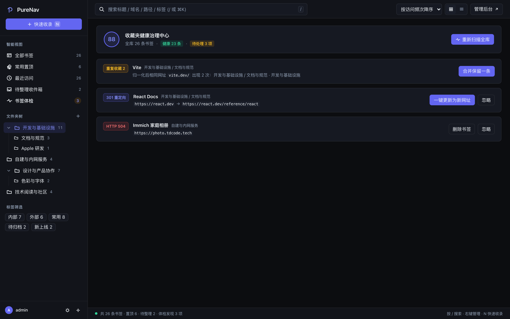

# PureNav

自托管的**收藏夹管理器 + 导航入口**。把浏览器里越积越乱的几百条书签收进来，用多级目录树、点击热度、防重收录与体检治理重新组织；前台即可原地管理，Docker 一键部署。

<p align="center">
  
</p>

<p align="center">
  
</p>

- **工作台**：固定视口三区布局（左侧智能视图 + 多级文件夹树 + 标签筛选 / 右侧顶栏搜索、排序、视图切换 / 底部状态栏）；子文件夹以紧凑药丸横排，消灭「单条目子分类独占整行」的留白洞
- **智能视图与热度**：全部 / 常用置顶 / 最近访问 / 待整理收件箱，跨文件夹聚合；每次打开自动累计 `visit_count`，可按热度或最近访问排序
- **1 秒快速收录**（`N`）：粘 URL 即抓标题、描述与图标，归一化后按域名查重，命中重复时琥珀色预警 + 一键合并；附带 Bookmarklet
- **原地管理**：右键（或卡片 `···`）呼出菜单——打开、切换内外网、置顶、移动到文件夹（打开文件夹选择器）、编辑、复制链接、移入待整理、删除；书签可**拖拽**到侧栏树节点或子文件夹药丸归档
- **手机可用**：≤860px 或触屏时顶栏只留「⋯」，书签/文件夹操作走底部面板，跨文件夹移动走全屏选择器，全部触控热区 ≥44px
- **书签体检**：健康分 + 重复网址 / 死链 / 永久重定向分类清单，一键重新扫描全库并逐条修复
- **多级书签无损导入**：解析 Netscape HTML 书签文件的文件夹路径，按 `parent_id` 逐级还原成真实目录树
- **单页工作台 + 原地编辑**：访客只读，登录后顶栏「编辑」开关切换成可编辑态；右下角两个抽屉分别是外观（站点标题/描述、主题、强调色、圆角、阴影、密度、卡片尺寸）与数据与备份（JSON 与浏览器书签 HTML 导入导出、体检重扫、收件箱入口）；分组结构的重命名/新建/删除/排序全部在左侧文件夹树内完成，不再有独立入口
- **拖拽**：编辑态下拖卡片到另一张卡片的前/后半区即改顺序，拖到侧栏文件夹节点、子文件夹药丸或「待整理收件箱」即归档；顺序按文件夹树序 + 组内 `sortOrder` 落库
- **文件夹树即结构操作面**：节点 hover 出 `＋`（建子目录）与 `⋯`（重命名 / 删除），节点本身可拖——落在目标行上 1/3 / 下 1/3 调整顺序、中间 1/3 换上级，提交整树快照；折叠状态按用户操作保留，不随刷新重置
- **通用**：站点级深浅色主题（访客无本地覆盖）、`/` 与 `⌘K` 聚焦搜索、SQLite 持久化、离线快照、`prefers-reduced-motion` 降级
- **部署**：单容器、SQLite、数据目录挂载；GitHub Actions 自动产出 `linux/amd64` + `linux/arm64` 镜像

## 快速开始

```bash
docker run -d --name purenav \
  -p 8090:8080 \
  -v $(pwd)/data:/data \
  --restart unless-stopped \
  ghcr.io/j9kkk/purenav:latest
```

打开 <http://localhost:8090>，首次访问会引导创建管理员账号。

> 容器内固定监听 `8080`，宿主机端口自选。若宿主机 `8080` 已被占用，改 `-p` 左侧即可。

### docker compose

```bash
docker compose up -d
```

默认映射 `${PURENAV_PORT:-8090}:8080`。改端口：

```bash
PURENAV_PORT=9000 docker compose up -d
```

本地从源码构建，把 `docker-compose.yml` 里的 `image:` 换成 `build: .`（或直接 `docker build -t purenav:local .`）。

## 键盘操作

| 按键 | 行为 |
| --- | --- |
| `/` 或 `⌘K` | 聚焦搜索框 |
| `N` | 打开快速收录（管理员） |
| `↑` `↓` | 在可见卡片间移动选择（自动跳过过滤掉的项） |
| `Enter` | 打开选中站点 |
| `Esc` | 关闭浮层 / 清空搜索并失焦 |
| 右键 | 书签卡片上呼出原地管理菜单 |

## 配置

全部通过环境变量，均有默认值，通常只需关心端口和数据目录。

| 变量 | 默认 | 说明 |
| --- | --- | --- |
| `PORT` | `8080` | 容器内监听端口 |
| `HOST` | `0.0.0.0` | 绑定地址 |
| `PURE_DATA_DIR` | `/data` | 数据目录（SQLite + 上传图标） |
| `PURE_WEB_DIST` | `/app/web-dist` | 前端构建产物位置 |
| `PURE_SESSION_TTL_DAYS` | `7` | 登录会话有效期 |
| `PURE_TRUST_PROXY` | `0` | 置于反向代理后设为 `1`，以读取真实客户端 IP |
| `PURE_SECURE_COOKIE` | `0` | 公网 https 部署建议设为 `1` |
| `PURE_LAN_PROBE_ORIGINS` | 空 | 允许浏览器探测的内网源，见下 |
| `LOG_LEVEL` | `info` | 日志级别 |

### 内网地址切换

站点可以同时配置公网地址与内网地址。内网地址只对**已登录**的会话下发，匿名访问者的接口响应里永远不含它。

登录后前台会在卡片右下角显示切换按钮：

- 默认自动探测内网可达性，可达走内网，否则回退公网
- 手动点击可强制切换，选择记在本地，刷新后仍然生效
- 登出后按钮消失，卡片回退到公网地址

浏览器探测会被 CSP 拦截并表现为"不可达"，因此需要在 `PURE_LAN_PROBE_ORIGINS` 里声明允许探测的源：

```bash
PURE_LAN_PROBE_ORIGINS="http://192.168.0.0 http://10.0.0.0"
```

不配置也能用，只是自动探测恒为不可达、只能靠手动切换。这是刻意的取舍：默认不放开任意 http 连接，避免扩大页面能力。

完整示例见 [`.env.example`](.env.example)。

### 数据

`/data` 下有两类内容，挂载后即可持久化、备份、迁移：

- `purenav.db`（含 `-wal`/`-shm`）—— 全量业务数据
- `assets/` —— 后台上传的图标文件

备份直接打包整个目录即可；升级镜像不会改动已有数据（启动时自动迁移）。

## 反向代理

置于 Nginx / Caddy / Traefik 之后时：

```nginx
location / {
    proxy_pass http://127.0.0.1:8090;
    proxy_set_header Host $host;
    proxy_set_header X-Forwarded-For $proxy_add_x_forwarded_for;
    proxy_set_header X-Forwarded-Proto $scheme;
}
```

同时设置 `PURE_TRUST_PROXY=1` 与 `PURE_SECURE_COOKIE=1`。

## 本地开发

需要 Node.js 22+。

```bash
npm install
npm run dev:server   # http://127.0.0.1:8080
npm run dev:web      # http://127.0.0.1:5173，已代理 API 到 8080
```

首次启动无账号时，打开 `/` 点右上角「登录」即进入初始化流程；登录后同一页面顶栏出现「编辑」开关。

```bash
npm run typecheck    # 前后端类型检查（含测试文件）
npm test             # 服务端集成测试
npm run build        # 构建 web + server
docker build -t purenav:local .
```

测试用 Node 内置 `node:test`，不引入额外依赖。覆盖认证边界、内网地址隔离、排序幂等性与集合校验、上传魔数/超限/格式限制、路径穿越。

> 由于数据库连接是模块级单例，每个测试文件运行在独立进程中、文件内共享一个 app 实例，测试数据通过独立分组隔离而非重置数据库。

## 发布

推送语义化版本 tag 即触发多架构镜像构建并推送到 GHCR：

```bash
git tag v0.1.0
git push origin v0.1.0
```

产出 `ghcr.io/<owner>/purenav`：`0.1.0`、`0.1`、`0`、`latest`、`sha-xxxxxxx`。PR 与 `main` 推送只跑 CI（类型检查、构建、镜像冒烟测试），不推送镜像。

镜像匿名拉取已验证可用（`docker pull ghcr.io/j9kkk/purenav:0.1.0`）。若你的账号策略默认把新包设为私有，需在仓库 **Packages** 设置里改为 `public`。

## 项目结构

```
apps/
  server/          Fastify + SQLite，API 与静态托管
    src/db/        迁移与连接（0003 起含收藏夹生命周期字段）
    src/lib/       认证、密码、设置、错误
    src/routes/    公共 / 认证 / 分组 / 站点 / 设置与资源
  web/             React + Vite 单页应用
    src/pages/     NavPage（收藏夹工作台）/ LoginPage / AdminPage
    src/nav-workspace.css   工作台样式（nx- 前缀，与应用其余样式隔离）
    src/lib/       书签 HTML 解析、主题、内网探测
docs/
  product/         需求与功能模块梳理
  design/          数据模型与接口设计
  design/nav-r7/   第七轮「收藏夹管理器」原型、规格与实现截图
```

数据模型、接口清单与关键设计取舍见 [`docs/design/data-model-and-api.md`](docs/design/data-model-and-api.md)，功能模块拆分见 [`docs/product/feature-modules.md`](docs/product/feature-modules.md)，工作台实现与原型逐项对照见 [`docs/design/nav-r7/README.md`](docs/design/nav-r7/README.md)。

## 安全说明

- 密码使用 Node 内置 scrypt 加盐哈希；会话只存 token 的 SHA-256，Cookie 为 `HttpOnly` + `SameSite=Lax`
- 所有非 GET 请求校验 `Origin` 同源；登录失败 10 次锁定 15 分钟
- 全站 CSP、`X-Frame-Options: DENY`、`nosniff`
- 站外地址仅接受 `http/https`；上传图标校验 magic bytes，且**不接受 SVG**（用户上传的 SVG 会带脚本在我们的 origin 下执行，净化难以做全，位图足够覆盖图标场景）
- **内网地址不会出现在匿名接口**：`/public/config` 永远不含 `lan_url`，仅 `/public/config/admin` 在会话校验后下发，且响应带 `no-store`

## License

MIT
