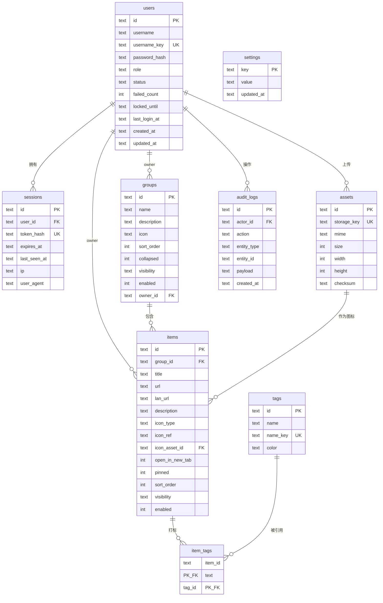

# PureNav 数据模型与接口设计

> 状态：设计草案 / 待评审
> 前置文档：`docs/product/feature-modules.md`
> 本文目标：把「分组 / 导航项 / 图标 / 权限 / 排序」这些容易返工的地方一次性定死。

---

## 0. 前提假设

项目当前为空仓库，以下为可替换的默认假设，标注了哪部分设计依赖它：

| 项 | 假设 | 影响面 |
| --- | --- | --- |
| 前端 | React + Vite（SPA） | 认证用 Cookie 而非 Bearer Token |
| 后端 | Node.js（Fastify / Hono 之一） | 接口风格 |
| 数据库 | SQLite（默认），Postgres 可选 | DDL 细节、ULID 主键 |
| 存储 | 本地目录（默认），S3 兼容可选 | `assets.storage_key` 抽象 |
| 部署 | 单容器，前后端同源 | 免 CORS、CSRF 可用 SameSite |

若最终选 Next.js 全栈或 Laravel/Go，**数据模型与接口契约不需要改**，只换实现。

---

## 1. 设计原则

1. **前台只读、后台受写**——两套接口，前台接口可被任意匿名访问，任何写操作都在 `/admin` 下且必须带会话。
2. **顺序显式化**——排序是数据（`sort_order`），不是数组下标；新增/拖拽都走"重排"语义。
3. **内网地址不进匿名响应**——安全边界在服务端，不依赖前端隐藏。
4. **图标只有一个真相**——`icon_type` + `icon_ref/icon_asset_id` 二选一，禁止多字段并存。
5. **配置整包可缓存**——前台一次请求拿全量，带版本号，支持本地快照秒开。

---

## 2. 数据模型

### 2.1 ER 图



### 2.2 字段说明（要点）

**groups**

| 字段 | 类型 | 说明 |
| --- | --- | --- |
| `id` | TEXT | ULID，客户端可读、导出跨实例不冲突 |
| `name` | TEXT | 分组名，≤ 40 字符 |
| `sort_order` | INTEGER | 稀疏排序（步长 1024），全站唯一作用域 |
| `collapsed` | 0/1 | 前台默认是否折叠 |
| `visibility` | `public`/`private` | `private` 不出现在匿名配置中 |
| `enabled` | 0/1 | 软下架，后台仍可见 |
| `owner_id` | TEXT | 为多用户预留，v1 恒为唯一管理员 |

**items**

| 字段 | 类型 | 说明 |
| --- | --- | --- |
| `url` | TEXT | 主地址（公网/默认），仅允许 `http/https` |
| `lan_url` | TEXT | 内网优先地址，**只下发给已认证管理员**，见 §5.2 |
| `icon_type` | TEXT | `auto`（抓 favicon）/`url`/`iconify`/`asset`/`text` |
| `icon_ref` | TEXT | `url` 时为图片地址，`iconify` 时为 `mdi:github` 形式 |
| `icon_asset_id` | TEXT | `asset` 时指向 `assets.id` |
| `open_in_new_tab` | 0/1 | 默认 1 |
| `pinned` | 0/1 | 置顶，前台排序时优先于 `sort_order` |
| `sort_order` | INTEGER | 组内作用域，与 `group_id` 组成逻辑键 |
| `visibility` / `enabled` | | 同上 |

> `icon_type` 与 `icon_ref/icon_asset_id` 用 CHECK 约束互斥（见 DDL），避免出现"既有上传又有 URL"的歧义态。

**settings**

单表 key-value，`value` 存 JSON。键名规范化，便于加字段：

| key | value 结构 |
| --- | --- |
| `site.identity` | `{ title, logo, favicon, description }` |
| `site.theme` | `{ mode: 'light'\|'dark'\|'auto', accent, radius, shadow }` |
| `site.layout` | `{ density, cardSize, showDescription, defaultView }` |
| `site.security` | `{ allowFaviconFetch, lanUnlockEnabled }` |
| `site.meta` | `{ version, setupCompletedAt }` |

不用"一列一字段"的宽表，是因为站点配置会持续加项，宽表每次都要迁移。

### 2.3 DDL（SQLite 方言）

```sql
PRAGMA foreign_keys = ON;

CREATE TABLE users (
  id            TEXT PRIMARY KEY,
  username      TEXT NOT NULL,
  username_key  TEXT NOT NULL,              -- lower(username)，供唯一约束
  password_hash TEXT NOT NULL,              -- argon2id
  role          TEXT NOT NULL DEFAULT 'admin' CHECK (role IN ('admin','viewer')),
  status        TEXT NOT NULL DEFAULT 'active' CHECK (status IN ('active','disabled')),
  failed_count  INTEGER NOT NULL DEFAULT 0,
  locked_until  TEXT,
  last_login_at TEXT,
  created_at    TEXT NOT NULL,
  updated_at    TEXT NOT NULL
);
CREATE UNIQUE INDEX ux_users_username_key ON users(username_key);

CREATE TABLE sessions (
  id           TEXT PRIMARY KEY,
  user_id      TEXT NOT NULL REFERENCES users(id) ON DELETE CASCADE,
  token_hash   TEXT NOT NULL,               -- sha256(raw token)，不落明文
  expires_at   TEXT NOT NULL,
  created_at   TEXT NOT NULL,
  last_seen_at TEXT,
  ip           TEXT,
  user_agent   TEXT
);
CREATE UNIQUE INDEX ux_sessions_token_hash ON sessions(token_hash);
CREATE INDEX ix_sessions_user ON sessions(user_id);

CREATE TABLE groups (
  id          TEXT PRIMARY KEY,
  name        TEXT NOT NULL,
  description TEXT,
  icon        TEXT,
  sort_order  INTEGER NOT NULL,
  collapsed   INTEGER NOT NULL DEFAULT 0,
  visibility  TEXT NOT NULL DEFAULT 'public' CHECK (visibility IN ('public','private')),
  enabled     INTEGER NOT NULL DEFAULT 1,
  owner_id    TEXT REFERENCES users(id) ON DELETE SET NULL,
  created_at  TEXT NOT NULL,
  updated_at  TEXT NOT NULL
);
CREATE INDEX ix_groups_order ON groups(sort_order);

CREATE TABLE assets (
  id          TEXT PRIMARY KEY,
  storage_key TEXT NOT NULL,
  mime        TEXT NOT NULL,
  size        INTEGER NOT NULL,
  width       INTEGER,
  height      INTEGER,
  checksum    TEXT,
  created_by  TEXT REFERENCES users(id) ON DELETE SET NULL,
  created_at  TEXT NOT NULL
);
CREATE UNIQUE INDEX ux_assets_storage_key ON assets(storage_key);

CREATE TABLE items (
  id              TEXT PRIMARY KEY,
  group_id        TEXT NOT NULL REFERENCES groups(id) ON DELETE CASCADE,
  title           TEXT NOT NULL,
  url             TEXT NOT NULL,
  lan_url         TEXT,
  description     TEXT,
  icon_type       TEXT NOT NULL DEFAULT 'auto'
                  CHECK (icon_type IN ('auto','url','iconify','asset','text')),
  icon_ref        TEXT,
  icon_asset_id   TEXT REFERENCES assets(id) ON DELETE SET NULL,
  open_in_new_tab INTEGER NOT NULL DEFAULT 1,
  pinned          INTEGER NOT NULL DEFAULT 0,
  sort_order      INTEGER NOT NULL,
  visibility      TEXT NOT NULL DEFAULT 'public' CHECK (visibility IN ('public','private')),
  enabled         INTEGER NOT NULL DEFAULT 1,
  owner_id        TEXT REFERENCES users(id) ON DELETE SET NULL,
  created_at      TEXT NOT NULL,
  updated_at      TEXT NOT NULL,
  CHECK (
    (icon_type = 'asset'   AND icon_asset_id IS NOT NULL) OR
    (icon_type = 'url'     AND icon_ref IS NOT NULL) OR
    (icon_type = 'iconify' AND icon_ref IS NOT NULL) OR
    (icon_type IN ('auto','text'))
  )
);
CREATE INDEX ix_items_group_order ON items(group_id, sort_order);
CREATE INDEX ix_items_title ON items(title);
CREATE INDEX ix_items_enabled ON items(enabled, visibility);

CREATE TABLE tags (
  id         TEXT PRIMARY KEY,
  name       TEXT NOT NULL,
  name_key   TEXT NOT NULL,
  color      TEXT,
  created_at TEXT NOT NULL
);
CREATE UNIQUE INDEX ux_tags_name_key ON tags(name_key);

CREATE TABLE item_tags (
  item_id TEXT NOT NULL REFERENCES items(id) ON DELETE CASCADE,
  tag_id  TEXT NOT NULL REFERENCES tags(id)  ON DELETE CASCADE,
  PRIMARY KEY (item_id, tag_id)
);
CREATE INDEX ix_item_tags_tag ON item_tags(tag_id);

CREATE TABLE settings (
  key        TEXT PRIMARY KEY,
  value      TEXT NOT NULL,                 -- JSON
  updated_at TEXT NOT NULL,
  updated_by TEXT REFERENCES users(id) ON DELETE SET NULL
);

CREATE TABLE audit_logs (
  id          TEXT PRIMARY KEY,
  actor_id    TEXT REFERENCES users(id) ON DELETE SET NULL,
  action      TEXT NOT NULL,                -- group.create / item.move / auth.login ...
  entity_type TEXT,
  entity_id   TEXT,
  payload     TEXT,                         -- JSON，变更前后差异
  ip          TEXT,
  created_at  TEXT NOT NULL
);
CREATE INDEX ix_audit_created ON audit_logs(created_at DESC);
CREATE INDEX ix_audit_entity ON audit_logs(entity_type, entity_id);
```

**Postgres 适配**：`0/1` 换 `boolean`；`TEXT` 时间换 `timestamptz`；ULID 用 `char(26)`；`CHECK` 语法通用。其余不变。

---

## 3. 排序模型

**作用域**：分组在全站一个序列；导航项在 `group_id` 内一个序列。

**步长**：新建时取 `max(sort_order) + 1024`。插入到中间取前后均值，空间耗尽（相邻差 < 2）时对该作用域整段重排为 `1024, 2048, ...`。

**拖拽落库**：前端不发送单个 `sort_order`，而是发送该作用域**完整有序 id 列表**，服务端在一个事务内重写。理由：单点更新在并发拖拽下会产生重复值，而整段重写天然幂等、可重放。

```
PUT /admin/items/order
{ "group_id": "g_01H...", "ordered_ids": ["i_3", "i_1", "i_2"] }
```

**跨组拖拽**：`PATCH /admin/items/:id` 带 `{ group_id, position }`，服务端把该项从原组摘除、插入目标组对应位置，并对**两个**作用域重排。一次事务内完成，避免前端两次请求导致中间态。

**读取顺序**：`ORDER BY pinned DESC, sort_order ASC, id ASC`。`id` 作为 tiebreak，保证任何脏数据下顺序仍然稳定可复现。

---

## 4. 接口约定

### 4.1 通用

- 前缀 `/api/v1`，破坏性变更才升版本。
- 成功：直接返回资源对象或 `{ items: [], total }`；不套 `{code,data}` 信封。
- 失败：HTTP 状态码 + 统一结构
  ```json
  { "error": { "code": "VALIDATION_FAILED", "message": "title 不能为空", "details": [{ "field": "title", "rule": "required" }] } }
  ```
- 时间统一 ISO-8601 UTC（`2026-10-22T02:11:00.000Z`），入库与出参一致。
- 分页：列表类小数据集用 `?page=&pageSize=`（默认 50，上限 200）；审计日志用游标 `?cursor=`。

### 4.2 错误码

| code | HTTP | 场景 |
| --- | --- | --- |
| `UNAUTHENTICATED` | 401 | 无会话或已过期 |
| `FORBIDDEN` | 403 | 角色不足 |
| `NOT_FOUND` | 404 | 资源不存在或不可见 |
| `VALIDATION_FAILED` | 422 | 字段校验失败 |
| `CONFLICT` | 409 | 唯一键冲突（重名标签等） |
| `RATE_LIMITED` | 429 | 触发限流，带 `Retry-After` |
| `UNSAFE_TARGET` | 400 | 抓取/探测目标命中 SSRF 拦截 |
| `INTERNAL` | 500 | 未预期错误，响应不含堆栈 |

### 4.3 认证与会话

- 登录成功下发 **HttpOnly + Secure + SameSite=Lax** Cookie（`pn_session`），值为随机 32 字节 opaque token；库中只存 `sha256(token)`。
- 不使用 JWT：单机部署没有跨服务校验需求，而需要**即时吊销**（改密、踢设备、封禁）。
- 有效期 7 天，`last_seen_at` 滑动更新；改密时删除该用户其它会话。
- CSRF：SameSite=Lax 覆盖大部分场景，再对**所有非 GET 请求**校验 `Origin` 与站点同源，缺失即拒绝。
- 首次启动：无任何用户时，`GET /auth/state` 返回 `{ needsSetup: true }`，仅此时允许 `POST /auth/setup` 创建管理员；创建成功后该端点返回 409。

### 4.4 限流

| 端点 | 限制 |
| --- | --- |
| `POST /auth/login` | 5 次/分钟/IP，连续失败 10 次锁定 15 分钟 |
| `POST /auth/setup` | 3 次/分钟/IP |
| `GET /icons/favicon` | 600 次/分钟，且**仅统计真正回源的请求**；缓存命中不计入 |
| `POST /icons/favicon`、`GET /icons/search` | 20 次/分钟/会话 |
| 其余写接口 | 120 次/分钟/会话 |

图标代理必须把缓存命中排除在限流之外：一个上千站点的实例，正常刷新一屏就会发出远超阈值的图标请求，把命中计入会让整页图标一起被 429 打回（表现为「改了某个图标，别的图标也跟着失效」）。

### 4.5 缓存

| 端点 | 策略 |
| --- | --- |
| `GET /public/config` | `ETag` = 全局版本号；`Cache-Control: no-cache`（必须回源校验，允许 304） |
| `GET /assets/:id` | `Cache-Control: public, max-age=31536000, immutable`（内容寻址，ID 不复用） |
| 其余 | `no-store` |

全局版本号：任一写操作成功后自增（存 `settings` 的 `site.meta.version`），用于 ETag 和前端本地快照失效判断。

---

## 5. 接口清单

### 5.1 匿名（前台）

| 方法 | 路径 | 说明 |
| --- | --- | --- |
| GET | `/public/config` | 整包配置：站点设置 + 可见分组 + 可见导航项 + 标签。不含 `lan_url` |
| GET | `/assets/:id` | 图标/Logo 静态资源 |
| GET | `/health` | `{ status, version, uptime }` |

### 5.2 认证

| 方法 | 路径 | 说明 |
| --- | --- | --- |
| GET | `/auth/state` | `{ needsSetup, authenticated, user? }`，前端启动时调用 |
| POST | `/auth/setup` | 首启创建管理员，仅无用户时可用 |
| POST | `/auth/login` | `{ username, password }` |
| POST | `/auth/logout` | 销毁当前会话 |
| GET | `/auth/me` | 当前用户与角色 |
| POST | `/auth/password` | `{ currentPassword, newPassword }`，成功后吊销其它会话 |
| GET | `/auth/sessions` | 登录设备列表（脱敏 IP、UA、时间） |
| DELETE | `/auth/sessions/:id` | 踢下线 |

### 5.3 分组

| 方法 | 路径 | 说明 |
| --- | --- | --- |
| GET | `/admin/groups` | 含每个分组的 `itemCount` |
| POST | `/admin/groups` | `{ name, description?, icon?, collapsed? }`，追加到末尾 |
| PATCH | `/admin/groups/:id` | 部分更新（不处理排序） |
| DELETE | `/admin/groups/:id` | 非空分组默认 409；`?cascade=true` 才级联删除 |
| PUT | `/admin/groups/order` | `{ ordered_ids: [...] }` |

### 5.4 导航项

| 方法 | 路径 | 说明 |
| --- | --- | --- |
| GET | `/admin/items` | `?group_id=&q=&enabled=&page=&pageSize=` |
| POST | `/admin/items` | `{ group_id, title, url, lanUrl?, description?, icon?, tags?, ... }` |
| PATCH | `/admin/items/:id` | 部分更新；可带 `{ group_id, position }` 实现跨组移动 |
| DELETE | `/admin/items/:id` | 硬删除（审计日志保留快照） |
| POST | `/admin/items/batch` | `{ op: 'enable'\|'disable'\|'delete'\|'move', ids: [], group_id? }` |
| PUT | `/admin/items/order` | `{ group_id, ordered_ids: [...] }` |

`icon` 入参统一结构，避免五套字段：

```json
{ "type": "iconify", "ref": "mdi:github" }
{ "type": "asset",   "assetId": "a_01H..." }
{ "type": "url",     "ref": "https://example.com/logo.png" }
{ "type": "text" }
{ "type": "auto" }
```

`tags` 传字符串数组即可，服务端按 `name` upsert 标签并重建关联。

### 5.5 标签

| 方法 | 路径 | 说明 |
| --- | --- | --- |
| GET | `/admin/tags` | 含被引用次数 |
| PATCH | `/admin/tags/:id` | 改名（同步 `name_key`）、改色 |
| DELETE | `/admin/tags/:id` | 连带删除 `item_tags` 关联 |

### 5.6 图标

| 方法 | 路径 | 说明 |
| --- | --- | --- |
| POST | `/admin/icons/upload` | `multipart/form-data`；限 `png/jpeg/webp/svg`，≤ 512KB；服务端统一裁切/缩放为 256×256 并落 `assets` |
| GET | `/admin/icons/search` | `?q=github`，代理 Iconify API，返回 `[{ id, name, previewUrl }]` |
| POST | `/admin/icons/favicon` | `{ url }`，服务端抓取并转存为 `asset`，返回 `{ assetId }` |

### 5.7 站点设置 / 导入导出 / 运维

| 方法 | 路径 | 说明 |
| --- | --- | --- |
| GET | `/admin/settings` | 全部设置项 |
| PATCH | `/admin/settings` | 按 key 深合并 |
| GET | `/admin/export` | `?format=json`（原生）\|`bookmarks.html`（浏览器书签格式） |
| POST | `/admin/import` | `?mode=merge\|replace`；`replace` 需二次确认参数 `confirm=REPLACE` |
| POST | `/admin/import/bookmarks` | `multipart/form-data` 上传 Netscape 书签 HTML |
| GET | `/admin/audit-logs` | `?cursor=&limit=&entity_type=&entity_id=` |
| GET | `/admin/config` | 后台专用整包配置，**含 `lan_url` 与停用/私有项** |
| GET | `/system/info` | 版本、DB 类型、存储类型、磁盘占用 |

---

## 6. 关键场景

### 6.1 前台首屏

目标是"打开即见内容"，动画不能等接口。

```
1. 读 localStorage['pn.config'] → 立即渲染（骨架屏仅首次访问时出现）
2. 并发 GET /public/config（带 If-None-Match）
   304 → 结束，不做任何重渲染
   200 → 差量更新 DOM（key 不变的元素不重挂载，避免动画重放）
3. 接口失败 → 保留快照 + 顶部提示"当前为离线缓存"
```

第 2 步的"不重挂载"是动效体验的关键：如果拿到新配置就整棵树重建，用户会看到第二次入场动画，观感比不快更差。

### 6.2 内网地址的可用性

`lan_url` 只通过 `GET /admin/config` 下发，匿名接口永远不含。由此推出两个后果，需要接受：

- 访客（未登录）只能走 `url`；
- 管理员在同一浏览器登录后，前台自动切换到含内网地址的配置。

**前端选择逻辑**：若存在 `lan_url`，先做可达性探测（`fetch(lanUrl, { mode: 'no-cors', signal: timeout(1200) })`，成功或返回不透明响应即视为可达），可达用内网，否则回退 `url`。探测结果按 URL 缓存 10 分钟。

**必须诚实说明的局限**：CORS 与 CSP `connect-src` 会让探测产生假阴性。因此**同时提供手动切换开关**，并记住用户选择，不让自动探测成为唯一路径。若站点开启严格 CSP，探测直接降级为"手动模式"。

> 可选的 P2 能力：`site.security.lanUnlockEnabled` 打开后，匿名访问者可凭站点口令换取一个短时会话（只解锁 `lan_url`）。默认关闭，避免把内网拓扑变相公开。

### 6.3 图标管线（SSRF 防护）

`POST /icons/favicon` 与 `GET /icons/search` 都会让服务端请求外部地址，必须统一走一个 `safeFetch`：

1. 仅允许 `http/https`；
2. DNS 解析后校验 IP：拒绝私有段、回环、链路本地、`0.0.0.0/8`、IPv6 ULA 与映射地址（防 DNS rebinding 需在**连接时**用解析结果，而非先解析再请求）；
3. 禁止跟随跨主机重定向（或每跳重新校验）；
4. 超时 5s，响应体上限 2MB，仅接受 `image/*`；
5. 校验真实类型（magic bytes），不信任 `Content-Type`；
6. 服务端重新编码为 WebP/PNG 后存储——这同时剥离 SVG 中的脚本与外部引用。

回退链固定为：`asset` → `iconify` → `url` → `auto(favicon)` → 文字首字母色块。前台只在最后一步渲染文字块，且色块颜色由标题哈希决定，保证同一站点颜色稳定。

`auto` 模式在服务端按以下顺序取图，**站点自身声明优先，第三方图标库只作兜底**：

1. 拉站点首页 HTML，解析 `<link rel="icon">` / `apple-touch-icon`，按声明尺寸取最大者（`mask-icon` 是单色蒙版，跳过）；
2. 首页无声明时读页面里 `<link rel="manifest">` 指向的 manifest，取其中最大的图标；
3. 仍无则退回约定俗成的 `/favicon.ico`；
4. 以上全部失败，才并发尝试第三方图标库（Google / DuckDuckGo），并带失败熔断。

只依赖第三方 CDN 会在网络受限的环境里让**所有** `auto` 图标一起失效，也会把一个站点的取图失败放大成整页空图标。抓取失败的结果同样缓存（2 分钟），避免每次刷新都重跑一遍超时链路；单次取图的总预算 8s，超时即交给前端降级。

### 6.4 删除与恢复

- 删除分组/导航项均为硬删除，但审计日志写入完整快照（`payload.before`）。
- v1 不提供"撤销"接口；恢复方式是从导出文件或审计日志手工重建。等真有需求再加回收站表，不提前复杂化。

---

## 7. 待确认

1. **认证形态**：本文按同源 SPA + Cookie 设计。若以后要做浏览器扩展或移动端，需要增加 Bearer Token 通道。
2. **是否需要分组嵌套**：当前为单层。加 `parent_id` 是低成本迁移，但会显著增加拖拽与折叠的交互复杂度，建议等真实反馈。
3. **多用户何时引入**：`users.role` 已预留 `viewer`，但权限校验逻辑 v1 不实现。若尽快要"只读访客分享"，应改为"分享链接 + 独立口令"，而不是给访客建账号。
4. **图标是否走 CDN**：`/assets/:id` 为 immutable，可直接挂 CDN；若做多实例同步，需要把 `storage_key` 作为唯一事实来源。
